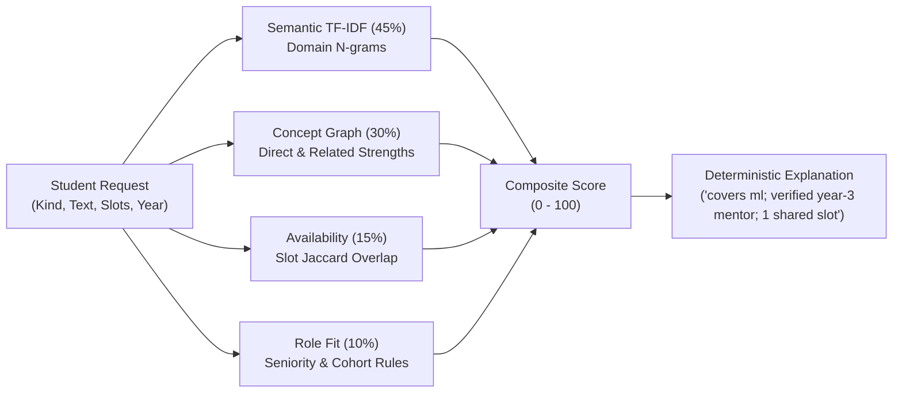
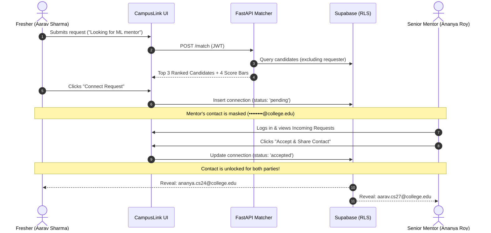

# CampusLink - System Architecture & Engineering Specifications

**FirstCommit '26 | Team EshWar (solo)**  
**Theme:** Campus & Student Life  
**Author:** Lokeswar PJ

---

## 1. High-Level System Architecture

```mermaid
flowchart TD
    subgraph Client ["Client Layer (Next.js 16 + Dark Tech Aesthetic)"]
        UI["Landing & App UI\n(/login, /profile, /requests, /connections, /library)"]
        ClientAuth["Auth State & Demo Switcher\n(Fresher vs Senior Mentor)"]
        ClientMatcher["Client-Side Fallback Engine\n(100% Demo Uptime)"]
    end

    subgraph Backend ["Inference & API Layer (FastAPI)"]
        API["FastAPI REST Routes\n(/match, /matches/:id/connect, /library, /health)"]
        AuthGuard["JWT Verification & Domain Policy\n(Bearer Token Check)"]
        Engine["Hybrid AI Matching Engine\n(0.45*Sem + 0.30*Cov + 0.15*Avail + 0.10*Fit)"]
        Explain["Deterministic Reason Builder\n(Attribution & Score Breakdown)"]
    end

    subgraph Data ["Persistence & Security (Supabase PostgreSQL)"]
        RLS["Row Level Security Policies"]
        ProfilesTable["profiles\n(Skills, Year, Mentorship, Slots)"]
        RequestsTable["requests\n(Intent, Kind, Plain Text, Slots)"]
        MatchesTable["matches\n(Scores, Parts, Explanations, Feedback)"]
        ConnectionsTable["connections\n(Zero-Trust Contact Shielding)"]
        ResourcesTable["resources\n(Verified Notes & Study Guides)"]
    end

    UI --> ClientAuth
    UI -->|POST /match (JWT)| API
    ClientAuth -.->|Offline fallback| ClientMatcher
    API --> AuthGuard
    AuthGuard --> Engine
    Engine --> Explain
    API --> RLS
    RLS --> ProfilesTable
    RLS --> RequestsTable
    RLS --> MatchesTable
    RLS --> ConnectionsTable
    RLS --> ResourcesTable
```

---

## 2. The 4-Part Hybrid Matching Formula

$$\text{Final Score} = 0.45 \cdot \text{Semantic} + 0.30 \cdot \text{Coverage} + 0.15 \cdot \text{Availability} + 0.10 \cdot \text{Fit}$$



---

## 3. Privacy & Zero-Trust Contact Exchange Sequence



---

## 4. Verification & Testing Summary

1. **Pytest Suite (`backend/tests/test_matcher.py`)**:
   - `test_deterministic_ranking`: Calling identical queries yields identical ranking.
   - `test_mentor_ranks_verified_senior_first`: Senior mentors are prioritized for mentorship queries.
   - `test_empty_profile_list_does_not_crash`: Edge-case stability.
   - `test_api_match_without_auth_rejected`: Returns HTTP 401 Unauthorized.
   - `test_api_match_with_valid_jwt`: Full contract payload verification.
   - `test_api_connections_and_feedback`: Response states.
   - `test_api_library_endpoint`: Notes search.
2. **Benchmark Precision & Recall**:
   - Hit@1: **100%** (vs. 77.8% keyword baseline).
   - Precision@3: **59.3%** (vs. 44.4% keyword baseline).
   - Recall@3: **94.4%** (vs. 74.1% keyword baseline).
3. **Frontend Production Build**:
   - 10 static & dynamic routes compiled in 2.5s with zero errors on Next.js Turbopack.
